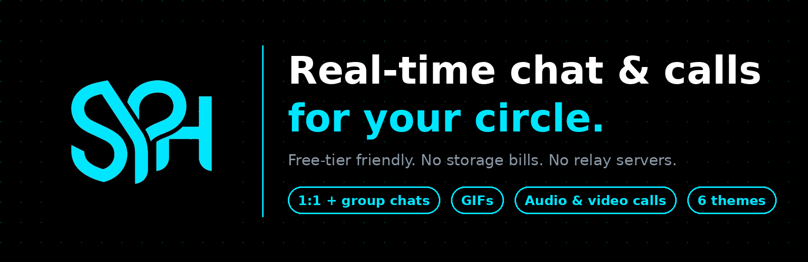
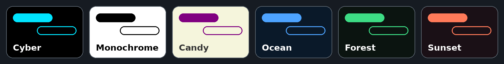
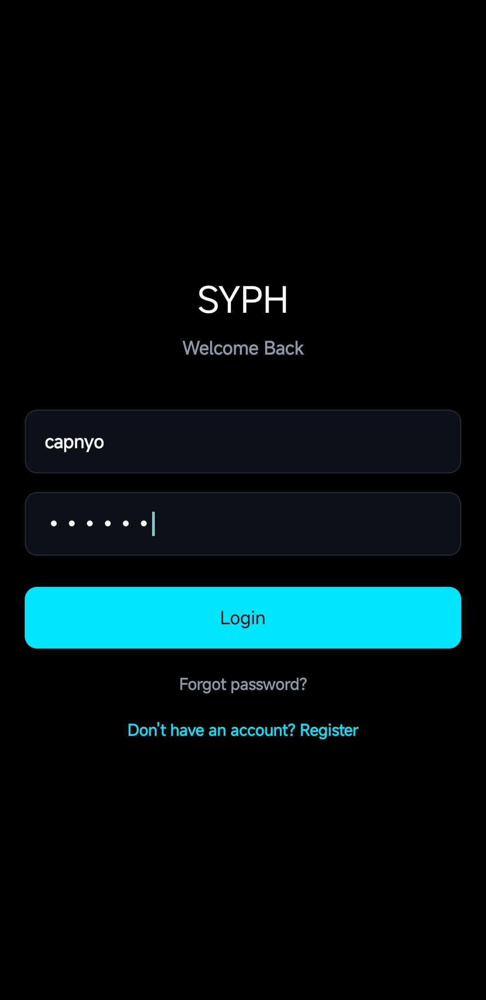
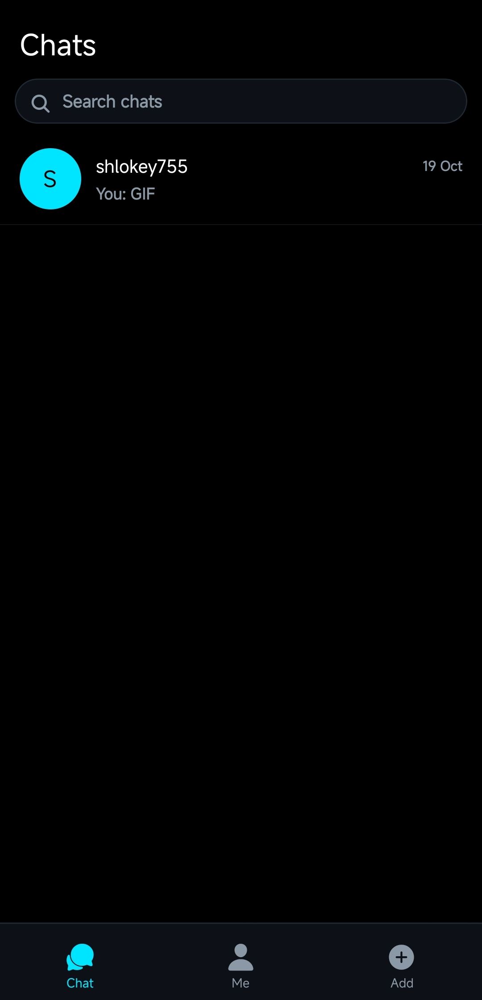
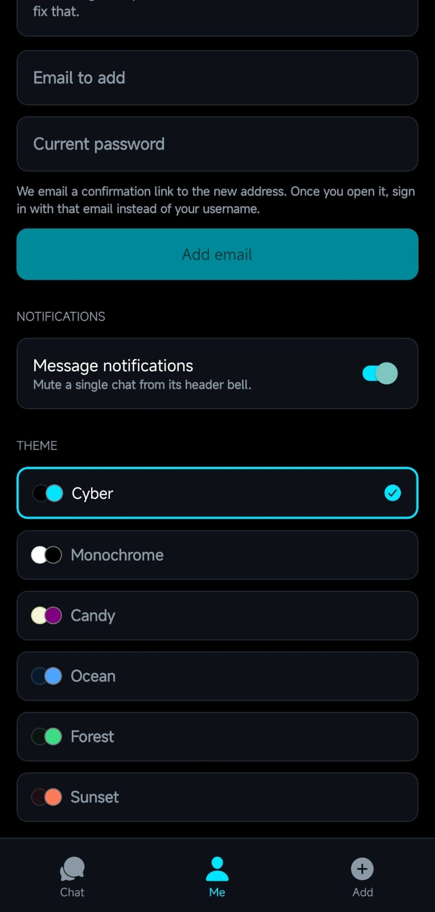
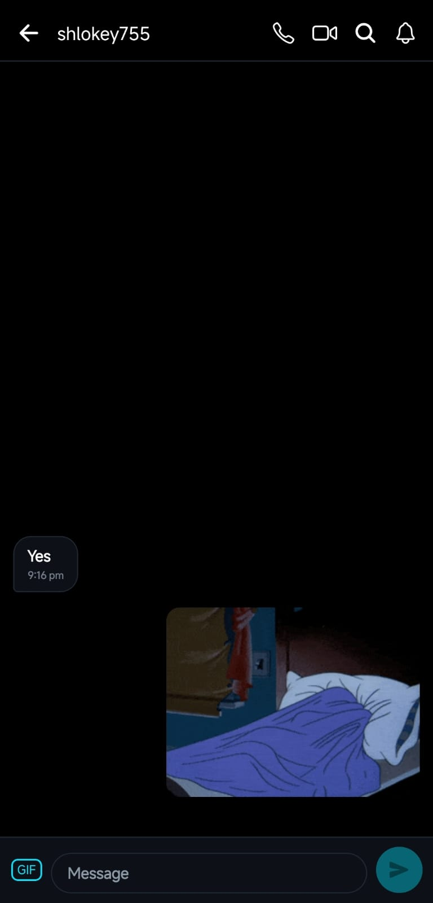
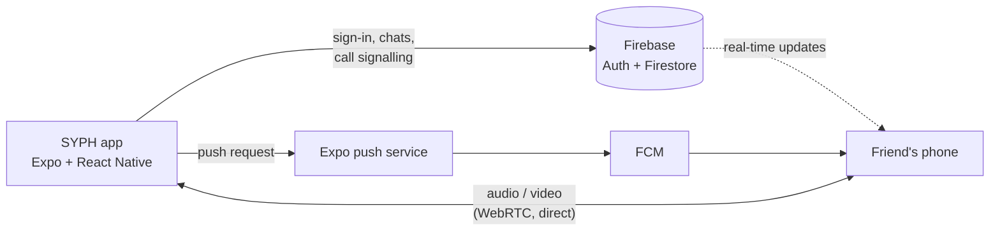

<p align="center">
  
</p>

<p align="center">
  <a href="https://github.com/shlokey755/SYPH/actions/workflows/ci.yml"></a>
  
  
  
  
  
</p>

<p align="center">
  <b>SYPH</b> is a real-time chat app for friends, built with React Native and Firebase,<br>
  offering one-to-one and group chats, GIFs, themes, read receipts, push notifications, and voice and video calls.
</p>

<p align="center">
  <a href="#-features">Features</a> ·
  <a href="#-screenshots">Screenshots</a> ·
  <a href="#-quick-start">Quick start</a> ·
  <a href="#-build-the-apk">Build the APK</a> ·
  <a href="#-how-it-works">How it works</a> ·
  <a href="#-roadmap">Roadmap</a>
</p>

---

##  Features

| | What you get |
|---|---|
|  **Chat** | One-to-one and group chats in real time. Reply, forward, copy, and delete for me or for everyone. Typing indicator and in-chat search. |
|  **Receipts** | Sent, delivered and read, shown on every message. |
|  **GIFs** | Built-in Giphy picker (needs a free Giphy key). |
|  **Calls** | One-to-one audio and video with a speaker toggle. Group calls with up to 4 on video or 6 on voice. |
|  **Notifications** | Push alerts while the app is closed, per-chat mute and a global switch. |
|  **Themes** | Six themes saved to your profile. The app icon follows your theme on Android. |
|  **Offline** | An offline banner, and messages you send are queued until you are back online. |
|  **Sign-in** | Username or email, password reset, optional display name. |

###  Themes

<p align="center">
  
</p>

##  Screenshots

<table align="center">
  <tr>
    <td align="center"><br><sub>Onboarding</sub></td>
    <td align="center"><br><sub>Chat list</sub></td>
    
  </tr>
  <tr>
    <td align="center"><br><sub>Themes</sub></td>
    <td align="center"><br><sub>Conversation</sub></td>
    
  </tr>
</table>

>  **These are placeholders.** To add real screenshots, replace the PNG files in [`docs/screenshots/`](docs/screenshots) with the same file names (around 1080 × 2340 works well). The README needs no edit.

##  Quick start

Run the everyday features (chat, GIFs, themes, search, typing) in Expo Go:

```bash
git clone https://github.com/shlokey755/SYPH.git
cd SYPH
npm ci
cp .env.example .env.local      # Windows Command Prompt: copy .env.example .env.local
# fill in your Firebase web values in .env.local
npx expo start -c --go
```

You need a Firebase project with **Authentication** (email/password) and **Firestore**, and the rules from [`firestore.rules`](firestore.rules) published. Step by step: [`API.md`](API.md).

> Calls, group calls, push while closed and the dynamic app icon need a real Android build, not Expo Go.

##  Build the APK

Builds run on [EAS](https://expo.dev/eas) (free tier). EAS skips git-ignored files, so your Firebase values live in EAS environment variables rather than in the repo.

| # | Step | Command |
|---|---|---|
| 1 | Install the CLI and log in | `npm i -g eas-cli` then `eas login` |
| 2 | Store your values in EAS, once per environment | `eas env:push preview --path .env.local` |
| 3 | Publish `firestore.rules` | Firebase Console → Firestore → Rules |
| 4 | Upload the FCM V1 key (for push) | `eas credentials` → Android → Google Service Account |
| 5 | Build | `eas build --profile preview --platform android` |

A build with missing Firebase values stops at its start with a clear message, instead of crashing on launch. Details and gotchas: [`API.md`](API.md).

##  How it works



- **Real time:** messages, read receipts and typing state are Firestore documents with live listeners.
- **Security:** access is membership-based and enforced by [`firestore.rules`](firestore.rules), not by hiding client config.
- **Calls:** WebRTC between phones. Firestore carries the signalling, and free STUN finds the route. Group calls are a mesh.
- **Push:** the sender's phone asks Expo's free push service to notify the recipient, so no server is needed. An optional relay lives in [`server/`](server).
- **No file storage:** chats carry text and GIF links only, so there is no Firebase Storage and no billing plan.

###  Tech stack

| Layer | Choice |
|---|---|
| App | Expo SDK 57, React Native 0.86, React 19.2, expo-router, TypeScript |
| Backend | Firebase Auth and Firestore (JS SDK 11) |
| Calls | react-native-webrtc 124, free STUN |
| Push | expo-notifications with FCM V1 |
| GIFs | Giphy |
| Builds | EAS Build |
| CI | GitHub Actions: typecheck, unit tests, Android bundle, relay tests |

##  Checks

```bash
npm run typecheck        # TypeScript
npm run test:unit        # unit tests
cd server && npm test    # push relay tests
```

CI runs the same checks, plus an Android bundle, on every pull request.

<details>
<summary><b> Project structure</b></summary>

```text
src/
  app/          screens and routes (expo-router): auth, tabs, chat, call, group-call
  components/   chat, call and profile UI
  hooks/        state: auth, themes, conversations, messages, calls, typing
  services/     Firebase, WebRTC and push code
  utils/        pure logic with unit tests
tests/          unit tests and Firestore rules tests
server/         optional push relay (Node)
scripts/        build helpers (EAS environment check)
firestore.rules security rules
eas.json        build profiles
```

</details>

##  Roadmap

| Status | Item |
|---|---|
|  Done | Chat, groups, receipts, GIFs, themes, push, typing, calls and group calls, dynamic app icon, splash |
|  Paused | Live location sharing (built, kept as a draft pull request) |
|  Planned | Hosted web version |
|  Not built | Google and phone sign-in, search across full message history |

##  Known limits

- **No TURN server** (it costs money), so a few network pairs cannot connect a call, mostly mobile data on both sides.
- **Push is sent from the sender's phone**, which must be online at that moment.
- **Android first.** iOS builds and push need a paid Apple developer account.
- Web is not supported yet.

##  More docs

| File | What is inside |
|---|---|
| [`API.md`](API.md) | Setup and everything the owner must provide: keys, rules, builds |
| [`MEMORY.md`](MEMORY.md) | Current state of the project and what is verified |
| [`JOURNEY.md`](JOURNEY.md) | How the project got here, and the problems solved on the way |

---

<p align="center">
  Made with ☕ by <a href="https://github.com/shlokey755">shlokey755</a>
</p>
